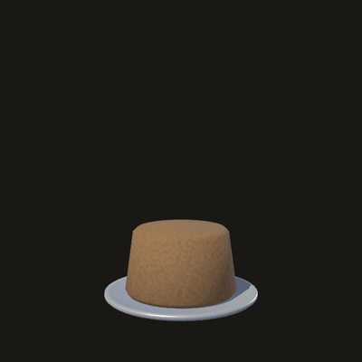
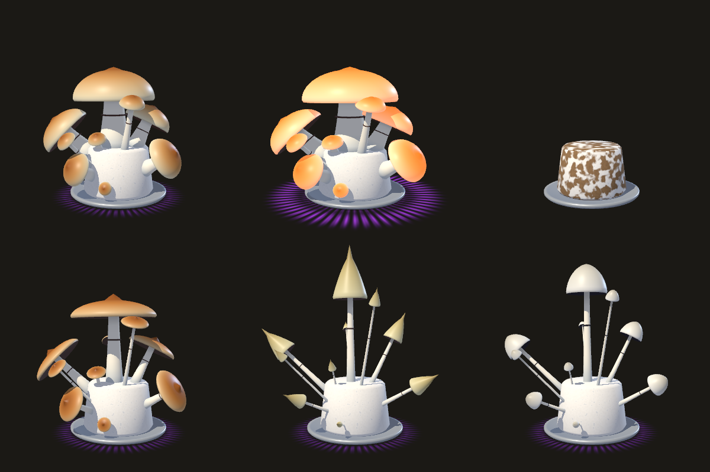

# Mushroom Widget

A desktop toy for Mac: a 3D PF Tek cake that floats on your desktop, grows mushrooms while your music plays, and bounces to the beat. For anyone who wants a small music visualizer that is alive instead of a bar graph.

| A full cake in ten seconds | Reacting to a beat |
|---|---|
|  |  |



Built with Godot 4.7 (one script, [main.gd](main.gd)) and a small Swift helper that listens to system audio.

## What it does

| | |
|---|---|
| **Grows on music** | The cake creeps along on its own (about an hour per cake) and grows about three times faster while audio is playing. Louder music and a misted cake grow faster still. |
| **Four stages** | Colonization (mycelium takes over the brown cake in patches), Pinning, Fruiting, Decay. |
| **Reacts to the beat** | The cake squashes and the mushrooms swell on the kick, wobble with the mids, the caps flash, a purple spore print on the table surges outward, and fruiting cakes throw spores. |
| **Ten species** | Each new cake is the next species (list below). |
| **Just the cake** | Transparent, borderless, always on top, slowly turning. No text. |

## Controls

- **Hover** the widget to show **Mist**, **Harvest** and **×**. Harvest's tooltip shows the species, stage, percent, harvest count and minutes of music.
- **Mist** raises humidity (faster growth). **Harvest** works while fruiting; once the cake decays it becomes **New cake**.
- **Drag** anywhere to move it. **Esc** or **×** quits. Progress is saved.

## Requirements

- macOS 14.2 or later (the audio helper uses Core Audio process taps). Built and tested on macOS 27, Apple silicon.
- [Godot 4.7](https://godotengine.org/download/macos/), as `/Applications/Godot.app` or `godot` on your PATH (`brew install --cask godot`).
- Xcode Command Line Tools, for `swiftc` (`xcode-select --install`).
- `ffmpeg`, only for rendering video loops.

## Run it

```sh
git clone https://github.com/austin80808/mushroom-widget.git
cd mushroom-widget
sh ears/build.sh
godot --path .
```

`ears/build.sh` compiles the audio helper once. Without it the cake still grows, it just can't hear anything.

To install it as an app in `~/Applications` instead:

```sh
tools/make_app.sh
```

The app carries a copy of this project and runs it with the Godot installed on the Mac (`/Applications/Godot.app`), so it needs Godot 4.7 but no export templates. Re-run the script after changing the project.

## System audio

`ears/` is **Mushroom Ears**, a tiny background app that taps the Mac's audio output (a Core Audio process tap, macOS 14.2 or later) and sends three loudness numbers (bass, mid, high) to the widget over local UDP. It records nothing, starts with the widget, and quits a few seconds after the widget closes. It works with any output device, including AirPods, with no audio rerouting.

The first time, macOS asks to let Mushroom Ears record system audio. Allow it.

`tools/make_app.sh` installs the helper beside the app, as `~/Applications/MushroomEars.app`, and the widget prefers that copy. macOS gives a helper that sits inside another app's bundle silence instead of audio.

**If the cake stops reacting after a rebuild:** rebuilding the helper changes its signature and macOS silently stops feeding it audio. Clear the stale permission, then start the widget and allow the prompt again:

```sh
tccutil reset AudioCapture local.mushroom-widget.ears
```

`ears/build.sh` skips the rebuild when the helper is already up to date, so this only happens when `ears/main.swift` changes.

## Species

All ten are psilocybin mushrooms. There are over 200 described species; adding one is a line in `SPECIES` in [main.gd](main.gd).

| # | Species | Look |
|---|---|---|
| 0 | *Psilocybe cubensis* | Fat stems, wide golden caps |
| 1 | *Psilocybe azurescens* | Broad flat caramel caps with a sharp nipple |
| 2 | *Psilocybe cyanescens* | Low chestnut caps |
| 3 | *Psilocybe semilanceata* | Liberty caps: tiny pointed cones on long thin stems |
| 4 | *Psilocybe mexicana* | Small tan bells |
| 5 | *Psilocybe tampanensis* | Small yellow-brown caps |
| 6 | *Psilocybe zapotecorum* | Tall, dark olive-brown |
| 7 | *Psilocybe baeocystis* | Olive cones |
| 8 | *Psilocybe caerulescens* | Low brown caps |
| 9 | *Panaeolus cyanescens* | Pale grey caps on very long thin stems |

Every cake also grows a few runts and skinny ones (the `MUSHROOMS` list).

## Feed it from anything

Growth can also come from outside. Send `grow <percent>` to UDP port 47808 on localhost:

```sh
echo "grow 5" | nc -u -w0 127.0.0.1 47808
```

A script, a cron job or a build hook can grow the cake this way.

## Render a loop for a video

```sh
tools/render_loop.sh track.mp3 30 40 88 0 1080
```

Arguments: track (mp3, wav or ogg), seconds, start %, end %, species number, size in pixels. The cake makes exactly one turn over the clip, grows from start to end, and reacts to the track. The result is `build/loop/<track>.mov`: ProRes 4444 with a transparent background and the audio. Needs `ffmpeg`.

## Stream overlay

For OBS and similar, swap the transparent background for a solid colour to chroma-key:

```sh
godot --path . -- --bg=00ff00
```

## Flags

Pass these after `--`:

| Flag | Effect |
|---|---|
| `--progress=75` | Start at a growth percent, without touching the save |
| `--species=3` | Pick a species |
| `--shot=/abs/path.png` | Save one frame and quit (`--size=1024` sets its pixel size) |
| `--bg=<hex>` | Solid background instead of transparent |
| `--beat` | Hold the beat pulse on, to check the glow |
| `--meter` | Print the audio levels once a second |
| `--input=<device>` | Listen to a microphone instead of system audio |
| `--track=<file> --seconds=N [--grow-to=X]` | Clip rendering, used by `tools/render_loop.sh` |
| `--m5=<ip>[:port]` | Experimental: send growth, species and beat levels over UDP (12-byte packets, 20 a second, default port 47810) for a companion display such as an M5Stack. No firmware is included yet. |

## Update and remove

Update: `git pull`, then re-run `tools/make_app.sh` if you installed the app.

Remove:

```sh
rm -rf ~/Applications/"Mushroom Widget.app" ~/Applications/MushroomEars.app
rm -rf ~/Library/"Application Support"/Godot/app_userdata/"Mushroom Widget"
rm -f ~/Library/Logs/MushroomEars.log
tccutil reset AudioCapture local.mushroom-widget.ears
```

## Notes

- This is art. It contains no cultivation instructions, and the "species" are colour and shape presets.
- Mac only. The widget itself is plain Godot, but the audio helper is Core Audio.
- Problems and ideas: open an issue. Small pull requests are welcome; a new species is one line in `SPECIES`.
- MIT licensed, see [LICENSE](LICENSE).

- Godot 4.7 cannot read the BlackHole loopback device on this setup (`AudioUnitRender` error -10863 on every frame), which is why system audio goes through the helper.
- The save file is `mushroom.cfg` in Godot's user data folder for "Mushroom Widget".
